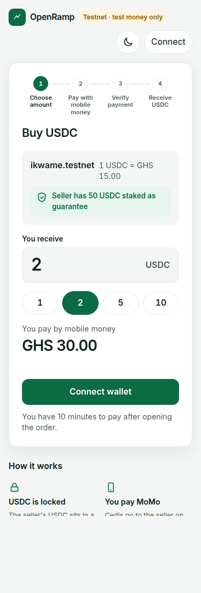
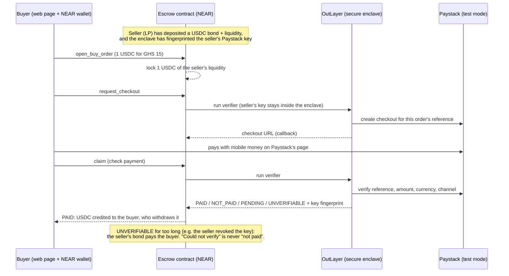

# OpenRamp

**Buy USDC with mobile money, without trusting the seller.** A NEAR escrow contract holds the
seller's USDC and releases it only when a program running in a secure enclave (an OutLayer TEE)
has asked the payment provider directly: "did this buyer pay this order?" If the seller's side
can't be verified, the seller's staked bond pays the buyer. There is no owner, no admin and no
dispute desk: the rules are in the contract.

First market: Ghana (MTN MoMo, Telecel Cash). Built for the NEAR Hackathon 2026, track
Real-World Money. **Testnet and Paystack test mode only: no real money moves.**



## How it works



- **Contract** (`contracts/escrow`, Rust, near-sdk 5.30): orders, LP bonds, timeouts, slashing.
  All settings are fixed when it is deployed; it has no owner role.
- **Verifier** (`verifier/`, Rust → wasm32-wasip2): runs inside OutLayer's enclave with the
  seller's own Paystack key, which never leaves the enclave. Fail-closed on anything unexpected.
- **Web page** (`web/`, Vite + plain JavaScript + NEAR Wallet Selector): guided 4-step buyer
  flow, a read-only seller page (`?seller`), light and dark.
- Design and rules: [`docs/SPEC.md`](docs/SPEC.md), threats: [`docs/THREAT_MODEL.md`](docs/THREAT_MODEL.md),
  every decision: [`docs/DECISIONS.md`](docs/DECISIONS.md), full history: [`docs/PROJECT_HISTORY.md`](docs/PROJECT_HISTORY.md).

## Proof on testnet

Escrow **[escrow-d2.ikwame.testnet](https://testnet.nearblocks.io/address/escrow-d2.ikwame.testnet)**
(verifier wasm sha256 `ecc0515c0ddff734c7e4732b986b1fed3b95454ee8801f99b1622457ec62bf7b`,
deploy and `new` in one transaction [87GcoZAa…](https://testnet.nearblocks.io/txns/87GcoZAa7FGSD1ST9vCcPt47FzmtyD5nMonMCXYWUk89)).

**PAID through the real Paystack checkout page (d2, order 0, Nov 10):**

| Step | Transaction |
|---|---|
| Enclave fingerprints the seller's real Paystack test key | [BobGuDx1…](https://testnet.nearblocks.io/txns/BobGuDx1P3ub7EeQbZtwc9n6WH9paZULDmdDVxZhyi1B) |
| Buyer opens order 0: 2 USDC for GHS 30 | [7XpaFuhL…](https://testnet.nearblocks.io/txns/7XpaFuhLLkdAgmiMHSheYubpG1eFNSMr9KJ22CVVxeRD) |
| Enclave creates the Paystack checkout with the seller's key | [9tRHeCYN…](https://testnet.nearblocks.io/txns/9tRHeCYNg8mm9DxdSGFHxkXWZM8dxmVbqXQB5cEAHAun) |
| Buyer paid on Paystack's page (test MoMo); check → `order_released` | [5dKzaxnq…](https://testnet.nearblocks.io/txns/5dKzaxnqqLjpCJTSfGvaUWybRa8SbT4aZLZyfCWq6aB6) |
| Buyer withdraws 2 USDC | [3TcS1rFm…](https://testnet.nearblocks.io/txns/3TcS1rFmn6ZEgDYVkFKGfJVPd1RRCjygaEmmPadu3t3V) |

**NOT_PAID and slash (earlier deploy d1, Nov 4):**

| Outcome | Transactions |
|---|---|
| Buyer never pays: check says not paid, order expires, nobody is slashed | [578ZZGyX…](https://testnet.nearblocks.io/txns/578ZZGyXfp4WzS2fPAQbaXf3aP5HPmy3CnXb16Cvgb6n), [HEubiXio…](https://testnet.nearblocks.io/txns/HEubiXioKTP1GXe8y3QpJNRW7B338KyN5G6eS2HUeWN8) |
| Seller's key is rejected (fake key): first check is an LP fault, second check 3 min later slashes the bond to the buyer | [AVz7QqGD…](https://testnet.nearblocks.io/txns/AVz7QqGD7w9ZB1EnZqQeF8ywLtSY4aJiJPwWCxy5XZ7M), [Hz3QLHuY…](https://testnet.nearblocks.io/txns/Hz3QLHuYosA7oirTpKmHyZ2Ktjvn4QnQbCJ6ggkquDyB), withdraw [6DeqoxB6…](https://testnet.nearblocks.io/txns/6DeqoxB6TR8zJBPqSDe5GnZZZb9HEW1wJwQmrjt8Vic4) |

## Try it

You need a NEAR **testnet** account in Meteor or Intear Wallet with about **1 testnet NEAR**
(each step is a transaction; most of the fee comes back). The seller on this deploy is
`ikwame.testnet`, so buy from any other account.

Prerequisites: [Rust via rustup](https://rustup.rs) (the repo pins 1.97.0 and rustup installs it
on first use) and Node.js 20 or newer.

```bash
cd web && npm install && npm run dev
```

Open the printed address, connect your wallet, choose 1 USDC, then: **Continue** → **Open Paystack
checkout** → pay on Paystack's page with Mobile Money, MTN, test number **0551234987** →
**I've paid, check payment** → **Withdraw to my wallet**. You have 10 minutes to pay.

- `?view=<account>` shows any account's orders read-only; `?seller` shows the seller's bond,
  liquidity, open orders and key fingerprint.
- Tests: `cd contracts && cargo test` (267 + 5), `cd verifier && cargo test` (20),
  `cd web && npm test` (12). Rust is pinned by `rust-toolchain.toml` (1.97.0).
- Scripts for your own deploy: `scripts/deploy-testnet.sh`, `scripts/lp-setup.sh`, `scripts/buy.sh`.

## Honest limits

- **Testnet and Paystack test mode only.** Paystack's terms don't allow crypto escrow in live mode.
  Real money needs licensed liquidity providers (Ghana's VASP Act 2025, Act 1154); in production
  OpenRamp is the trust layer between users and licensed LPs (`docs/DECISIONS.md` D-010 to D-012).
- **Buy flow only.** The sell flow (USDC → cedis) is designed in the SPEC and its payout check was
  tested in the pawaPay sandbox (Test B2), but it is **not built**.
- **Depends on OutLayer testnet uptime.** If OutLayer doesn't answer, nothing is lost: a payment
  link isn't created, or a check counts as "couldn't verify" (never "not paid"). On the evening of Nov 11
  (from about 21:50 GMT) OutLayer testnet stopped running programs for everyone, other projects
  too; the page now says so in plain words.
- **Short demo timers.** 10 minutes to pay, 2 minutes grace, 3- and 6-minute windows before a slash.
  Production would use hours (D-012: 24 h for seller faults, 72 h for outages).
- **One seller per page.** The contract has no "list sellers" view; the page shows this deploy's LP.
- **Paystack's checkout is behind a bot check**, so the payment step can't be automated; the
  end-to-end PAID run above was done by a person.
- **No CI.** Tests run locally before each merge; nothing runs on GitHub yet.
- **Builds are not yet reproducible.** The deployed contract and verifier come from local builds
  (a Docker Hub rate limit blocked the reproducible build). The verifier wasm is in `wasm/` and
  its sha256 is fixed in the contract.
- **The escrow account still has a full-access key** on this testnet deploy, so whoever holds it
  could replace the code. The final deploy removes it; see "Upgrade keys" below.

## Built during the hackathon

Everything in this repository was written during the build window: the first commit is
`ee31eb5` on 2026-11-01 14:52 UTC. There is no pre-hackathon baseline.

**NEAR integration built in the window** (this is what is judged):
- `contracts/escrow`: the escrow contract on NEAR testnet. It handles buy orders, seller bonds
  and liquidity in a NEP-141 token, timeouts, slashing, claimable payouts and NEP-297 events.
  It has no owner and is initialised once by itself.
- OutLayer calls from the contract: `request_execution` with the fixed verifier wasm, plus
  callbacks that never trust the payload (`contracts/escrow/src/outlayer.rs`).
- `verifier/`: the OutLayer program that checks Paystack inside the enclave.
- `contracts/mock-ft`: a test-only NEP-141 mock USDC.
- `web/`: NEAR Wallet Selector login, wallet-signed contract calls, and JSON-RPC reads.
- `scripts/`: testnet deploy, LP setup and buyer scripts.

**Libraries and tools** (versions pinned in the lockfiles):
- Contracts: `near-sdk` 5.30 and `near-contract-standards` 5.30.
- Verifier: `serde`, `serde_json`, `sha2` 0.10, `wasi-http-client` 0.2.
- Web: `@near-wallet-selector/core`, `modal-ui-js`, `meteor-wallet` and `intear-wallet` 10.1.4;
  `@near-js/transactions` 2.5.1; `buffer` 6.0.3; Vite 8.
- Tooling: cargo-near 0.22, near-cli-rs, the OutLayer CLI.
- Template: `scripts/test-a/hello` started from `outlayer create hello` (a feasibility test only,
  not part of the product).

**AI-generated code.** Most of the code, tests and docs were written by AI coding agents,
directed and reviewed by Kwame (the team):
- **Claude Code** (Anthropic) wrote most of the repository: the contract, verifier, scripts, web
  page and docs. Commits authored "Claude" are its work. Some later commits under Kwame's name
  were also written by Claude Code and re-authored at his request: `d332367` and the commits from
  `9b2eb39` to `a2f6033`.
- **Cursor** wrote the buyer-page redesign in `0fcfee0`.
- **Kwame** made the product and design decisions, set up the accounts, keys and Paystack /
  OutLayer secrets, ran the manual tests (including the real Paystack checkout payment), and
  reviewed and merged the pull requests. GitHub merge commits under his name are those merges.

## Upgrade keys

The contract has no owner and no setter: nobody can change its rules or move funds through it.
But a NEAR account's **full-access key** can deploy new code to that account. On `escrow-d2` that
key is still present (it is the same key as `ikwame.testnet`), kept while we iterate on testnet.
For the final deploy the plan is:

1. Build the escrow reproducibly and deploy it with `new` in one transaction
   (`scripts/deploy-testnet.sh`).
2. Check `get_config` and the on-chain code hash against the reproducible build.
3. Delete the escrow account's full-access key:
   `near account delete-keys <escrow> public-keys <key> network-config testnet sign-with-…`.
   From then on the code can never change: bugs are fixed by deploying a new escrow, and sellers
   move their funds there.

## Buyer email (Paystack checkout)

Paystack requires a customer email to create a checkout (`/transaction/initialize` rejects a
request without one, and also rejects `.example` addresses). The checkout request travels through
a public NEAR transaction, so a real email there would be personal data on-chain (SPEC §8 inv. 7). So:
- *Demo (built):* every checkout uses one synthetic address, `buyer@example.com` (a reserved
  domain with no inbox). Paystack's receipt email goes nowhere; the buyer's receipt is the
  on-chain order and its `order_released` event. The buyer types only their MoMo number, and
  only on Paystack's own checkout page, never in OpenRamp.
- *Real buyers (not built):* the buyer still never puts an email on-chain. The checkout uses a
  per-order alias derived from the payment reference (e.g. `opr-<tag>-<id>@receipts.<domain>`).
  A buyer who wants Paystack's receipt gives their real email once, off-chain, to the alias
  forwarder that the deployment runs. A licensed LP that already knows its customers (KYC)
  can map the alias to the customer in its own records instead. Either way the contract and
  the verifier only ever see the alias.

## License

MIT, see [LICENSE](LICENSE).
