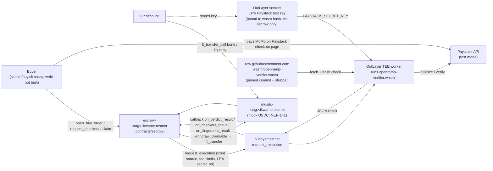

# OpenRamp: Project History

The living record of this project, built from the full git history (`git log --stat`, oldest
first) and the code as it stands. Where a commit's purpose is not clear from its message, diff or
the docs it touched, this file says so. Detailed session notes stay in `docs/PROGRESS.md`; the
reasoning behind each choice stays in `docs/DECISIONS.md` (D-numbers below point there).

---

## 1. Overview

**What it does.** OpenRamp is a peer-to-peer ramp between mobile money and USDC on NEAR. A buyer
pays cedis by mobile money to a liquidity provider (LP). A NEAR escrow contract releases the LP's
USDC to the buyer only when a program running in an OutLayer TEE (trusted execution environment)
has checked the payment directly with the payment provider using the LP's own API key. If the LP's
side can't be checked (for example, the LP revoked its key) and this lasts beyond a retry window,
the LP's bond is slashed to the buyer. There is no owner, admin or dispute path (D-003, D-014).
First market: Ghana. Demo rails: Paystack **test mode** (collections) only. No real money.

**Scope today (PLAN v0.2, Nov 4):** buy flow only (cedis → USDC). The sell flow (USDC → cedis,
pawaPay sandbox payouts), NEAR Intents settlement, the keeper and the agent API are cut or dropped;
their designs and sandbox proofs stay in the docs.

**Stack**
| Part | Tech |
|---|---|
| Escrow contract | Rust, near-sdk 5.30, `contracts/escrow` |
| Test token (mUSDC) | near-contract-standards 5.30 NEP-141, `contracts/mock-ft` (test only, D-013) |
| Verifier (TEE program) | Rust → `wasm32-wasip2`, serde_json, sha2 0.10, wasi-http-client 0.2, `verifier/` |
| TEE / oracle | OutLayer (`outlayer.testnet`), `request_execution` + callback |
| Payment provider | Paystack test mode API (`/transaction/initialize`, `/transaction/verify`) |
| Tooling | Rust 1.97.0 pinned (`rust-toolchain.toml`), cargo-near 0.22.0, near-cli-rs, outlayer CLI |
| Network | NEAR testnet |

**How to run**
```bash
# contract tests (escrow + mock token)
cd contracts && cargo test
# verifier tests
cd verifier && cargo test
# build the contracts' wasm (testnet deploys so far used the non-reproducible build)
cd contracts/escrow && cargo near build non-reproducible-wasm   # same in contracts/mock-ft
# build the verifier wasm and print its sha256
cd verifier && sh build.sh
```
Testnet (needs `NEAR_ACCOUNT_ID`, `NEAR_PRIVATE_KEY`; see `.env.example`):
1. `VERIFIER_URL=<raw GitHub URL pinned to a commit> VERIFIER_HASH=<sha256> scripts/deploy-testnet.sh <tag>`
2. The LP stores its Paystack test key as an OutLayer secret bound to the verifier hash, readable
   only through the escrow (`--access allow-all --via escrow-<tag>.<parent>`).
3. `scripts/lp-setup.sh <tag> <lp_account> <secret_profile>` (mint, register, bond, liquidity,
   fingerprint).
4. `scripts/buy.sh <tag> buyer | open | checkout | claim | expire | withdraw | order | claimable`.

---

## 2. Current architecture

**Components**
- **Escrow** (`contracts/escrow/src`):
  - `lib.rs`: state, fixed `Params`, `new` (callable only by the contract itself);
  - `lp.rs`: LP registry, bond and liquidity, withdrawals, secret ref, pause;
  - `orders.rs`: buy orders, GHS rounding, references `opr-<deploy_tag>-<id>`, expiry, views;
  - `verdicts.rs`: verdict handling, failure classes, slash, claimable balances, payouts;
  - `outlayer.rs`: `claim`, `request_fingerprint`, `request_checkout` and their callbacks;
  - `events.rs`: NEP-297 events.
  - Tests sit next to the code in `*_tests.rs`.
- **Verifier** (`verifier/src`):
  - `lib.rs`: pure decision logic (`decide`, `checkout_result`, `key_fp`, `reference_is_valid`);
  - `main.rs`: reads the input JSON, takes the key from the OutLayer secret `PAYSTACK_SECRET_KEY`,
    calls Paystack over wasi-http and prints one JSON line.
  - Modes: `fingerprint`, `checkout`, `verify`.
- **Built verifier** (`wasm/openramp-verifier.wasm`): served to OutLayer from a raw GitHub URL
  pinned to a commit, checked by its sha256 (D-008).
- **Scripts:**
  - `scripts/deploy-testnet.sh`, `lp-setup.sh` and `buy.sh` for testnet;
  - `scripts/test-a` and `scripts/test-b` hold the feasibility tests (records, not product code).
- **Not built:** `web/` (M4), `settlement/` (cut), `agent-api/` (dropped, D-010).



**Deployments (NEAR testnet, parent account `ikwame.testnet`)**
| Deploy | Escrow / token | Verifier hash | deploy_tag | Status |
|---|---|---|---|---|
| d1 | `escrow-d1` / `musdc-d1` | `6a9ff46b…926f` | `f51ae4a2` | Used for the slash, PAID (via the charge API) and NOT_PAID runs on Nov 4. Its checkout mode fails because Paystack rejects the old email (superseded by d2). |
| d2 | `escrow-d2` / `musdc-d2` | `ecc0515c…bf7b` | `ad88e13b` | Current demo deployment. Deployed Nov 4 (escrow deploy + `new` tx 87GcoZAa7FGSD1ST9vCcPt47FzmtyD5nMonMCXYWUk89). Nov 10: real key stored as `paystack-d2`, fingerprinted, and order 0 paid through the real Paystack checkout page → PAID → released (tx links in PROGRESS Session 5). |

Both escrows are built from the code merged in PR #14; they differ only in the verifier hash
fixed at init.

---

## 3. Timeline

Dates are commit dates (UTC). "PR #n" means `Ikwame91/near-momo-p2p#n`. Merge commits are listed
with their PR.

### Phase 1: Setup and planning (Nov 1)
- **2026-11-01, `ee31eb5`:** project created.
  - What: agent rules (AGENTS.md, CLAUDE.md), SPEC, THREAT_MODEL, PLAN, PROGRESS, DECISIONS,
    PROMPTS, `.env.example`, LICENSE (MIT), README.
  - Why: D-001 (build this ramp instead of FeeRail), D-005 (name), D-006 (agent workflow files).
- **2026-11-01, `98c5f51`:** plan approval and session 1 handoff recorded (PLAN, PROGRESS, SPEC).
- **2026-11-01, `ff5180a`:** secrets check recorded.
  - What: NEAR keys come in as env vars; the Paystack key is injected by the network proxy, not an
    env var (`.env.example`, PROGRESS).
- **2026-11-01, `3d70a8e`:** M0.2, toolchain installed (cargo-near, near-cli-rs, outlayer CLI).
  - Docs only (PLAN, PROGRESS). OutLayer's `install.sh` was blocked, so the CLI came from crates.io.

### Phase 2: Feasibility Test A, OutLayer (Nov 1)
- **2026-11-01, `5db4208`:** M0.3 partial.
  - What: OutLayer hello-world project (`scripts/test-a/hello/*`) builds.
  - Blocked on testnet funds.
- **2026-11-01, `d15462a`:** OutLayer on-chain round trip works; fetching the wasm is blocked by a
  FastFS testnet outage (PROGRESS).
- **2026-11-01, `2b53680`, `ca57f8b`:** hello.wasm committed to `wasm/` and run via a raw GitHub URL.
  - Why: FastFS was down, D-008.
  - Files: `wasm/hello.wasm`, `wasm/README.md`, DECISIONS.
- **2026-11-01, `f238c44`:** PR #1 merged.
- **2026-11-01, `4122a1c`:** M0.4, a testnet contract calls OutLayer and stores the callback result.
  - Files: `scripts/test-a/contract/*`, THREAT_MODEL.
- **2026-11-01, `14ff01b`, `cfe9ccd`:** Paystack verifier prototype (`scripts/test-a/paystack-verify/*`,
  `wasm/paystack-verify.wasm`, `verify-run.sh`) runs on OutLayer; UNVERIFIABLE case done.
- **2026-11-01, `8165cdf`:** M0.5 done.
  - What: the verifier returns PAID / NOT_PAID / UNVERIFIABLE from real Paystack test data.
  - Docs only.
- **2026-11-01, `2b0df3f`, `8b501bd`:** main merged into the branch; PR #2 merged.

### Phase 3: Security audit (Nov 1)
- **2026-11-01, `4b42309`:** Kwame added `claude/agents/security-auditor.md` (a reviewer agent
  definition).
  - The commit message says only "with auditing instructions"; no doc records why it was added then.
- **2026-11-01, `511f2f3`:** M0.10, security design update from an audit.
  - What: SPEC v0.2, THREAT_MODEL T23–T30, D-009.
  - Also moved the agent file to `.claude/agents/`.

### Phase 4: Payout feasibility and scope (Nov 1–3)
- **2026-11-01, `1217955`:** Test B (`scripts/test-b/run.py`).
  - Result: the MoMo charge works, but a Paystack Starter account cannot send transfers.
- **2026-11-01, `ea500c4`:** the buy flow becomes the main demo and sell-flow payouts are simulated
  (D-010); the agent API is dropped.
  - Files: AGENTS/CLAUDE, README, SPEC, PLAN.
- **2026-11-01, `a1bee6a`:** Test B script: only `transfer_unavailable` counts as "blocked" (exit 2);
  other transfer errors fail.
- **2026-11-02, `c759d98`:** PR #3 merged (commit date Nov 2).
- **2026-11-02, `8207f1e`:** decisions recorded.
  - What: pawaPay sandbox for sell payouts (D-011); slash timing by failure class (D-012); SPEC v0.3.
- **2026-11-03, `10ae29f`:** PR #4 merged.
- **2026-11-03, `48ddcbe`:** Test B2 (`scripts/test-b/pawapay_payouts.py`).
  - Result: pawaPay sandbox payouts work, and the status reply returns the recipient phone.
- **2026-11-03, `cf01093`:** PR #6 merged.

### Phase 5: Escrow contract, M1 (Nov 3–4)
- **2026-11-03, `9f45845`:** M1.1, escrow scaffold with fixed deploy config, plus the mock USDC token.
  - Files: `contracts/*`. Decision: D-013.
- **2026-11-03, `c3e90b5`:** M1.1 fix-up.
  - What: no owner (D-014); `new` callable only by the contract; OutLayer call limits; Rust pinned
    (D-015, `rust-toolchain.toml`).
- **2026-11-03, `864790e`:** the reproducible contract build is blocked by the Docker Hub rate limit
  (HTTP 429), to be retried before deploy.
- **2026-11-03, `5786280`:** PR #5 merged.
- **2026-11-03, `7928297`, `af6dbe0`:** M1.2, LP registration, bond and liquidity deposits, withdrawals
  (`lp.rs`, `lp_tests.rs`).
- **2026-11-03, `a66c6b1`:** PR #7 review fix-ups (D-016).
  - What: quote changes require 1 yocto; safer withdrawal gas; ceilings on settings; mint cap on
    the mock token.
- **2026-11-03, `231b3be`, `35154b8`:** main merged into the LP branch, keeping both PROGRESS entries;
  PR #7 merged.
- **2026-11-03, `89f770e`, `17f63ea`:** decisions before M1.4.
  - What: D-017 (pending = outage, one provider per LP, checkout through the escrow, 401-only
    LP fault, `agents` track dropped); D-018 (sell recipient commitment via pawaPay metadata,
    `scripts/test-b/pawapay_metadata_probe.py`).
  - PR #8 merged.
- **2026-11-03, `8ce2699`:** M1.3.
  - What: NEP-297 events (`events.rs`), provider limit, secret lock while orders are open, bond
    rule, pause/resume (`lp_m13_tests.rs`).
- **2026-11-03, `96f3acb`, `2398bb5`, `cfeb4d8`, `9644154`:** PR #9 review fix-ups, then PR #9 merged.
  - What: stricter unlock, profile charset, lowercase pots.
  - Docs: D-019 PR process.
  - Unclear: `2398bb5` and `cfeb4d8` have nearly the same message; the first touched only PLAN.md
    and the second the other docs. It looks like one change split over two commits.
- **2026-11-03, `42a0aca`:** M1.4, buy orders.
  - What: references, GHS rounding, limits, expiry, views (`orders.rs`, `orders_tests.rs`).
- **2026-11-04, `5200c72`, `8c29ec2`:** PR #10 review fix-ups (D-020), then PR #10 merged.
  - What: O(1) order indexes, new-buyer history per (LP, buyer), order storage charged up front.
- **2026-11-04, `889ec74`:** M1.5, verdict handling, release, release delay, claimable payouts
  (`verdicts.rs`, `verdicts_tests.rs`).
- **2026-11-04, `1ce140c`, `bc44db6`:** PR #11 review fix-ups (D-021), then PR #11 merged.
  - What: the verdict path schedules no transfer; no order can stay stuck in VERIFYING.
- **2026-11-04, `bc08be7`:** M1.6, slash from the bond, automatically when the failure window is met
  (`slash_tests.rs`).
- **2026-11-04, `f4ed7a2`, `dd230da`:** PR #12 review fix-ups (D-022), then PR #12 merged.
  - What: PENDING from a check claimed after the grace window is NOT_PAID; slash windows are
    measured fairly.

### Phase 6: Schedule compression (Nov 4)
- **2026-11-04, `9f82951`, `6e3bb27`:** PLAN v0.2, then PR #13 merged.
  - What: build done by Nov 6, submit Nov 11, buy flow only, list of cuts, D-022 kept.
  - Why: Kwame's timeline.

### Phase 7: OutLayer integration and first testnet runs (Nov 4)
- **2026-11-04, `1676129`:** M1.7, the books check (inv. 6) as one test across all buy flows
  (`books_tests.rs`).
- **2026-11-04, `ccd6332`:** Verifier v2 (`verifier/*`, `wasm/openramp-verifier.wasm`, D-023).
  - What: fingerprint / checkout / verify modes, PENDING, `key_fp`, strict reference format.
- **2026-11-04, `ef9d04d`:** escrow ↔ OutLayer wiring (`outlayer.rs`, `outlayer_tests.rs`).
  - What: payable `claim`, `request_fingerprint`, `request_checkout`; callbacks never panic on the
    payload.
- **2026-11-04, `8262b81`, `de4c9b4`:** testnet scripts.
  - `deploy-testnet.sh`: mock token, plus escrow deploy + `new` in one tx signed by the escrow (T32).
  - `lp-setup.sh` and `buy.sh`.
- **2026-11-04, `2f7a246`:** testnet deploy d1 and the on-chain slash demo recorded.
  - What: a fake key leads to two `auth_error` checks, then a slash paid to the buyer.
  - M2.4 ticked; tx links in PROGRESS.
- **2026-11-04, `4d6fef2`:** checkout email changed from `buyer@openramp.example` to
  `buyer@example.com`, with a test; `buy.sh expire` step added.
  - Why: Paystack returned 400 `invalid_email_address`, so checkout failed on d1.
- **2026-11-04, `6d209e4`:** PAID and NOT_PAID runs with Kwame's real Paystack test key recorded.
  - PAID: the payment was made with the charge API, not the checkout page.
  - NOT_PAID: the order expired with no slash.
  - M2.3 ticked.
- **2026-11-04, `e64d8ac`:** PR #14 merged (all of Phase 7).

### Phase 8: d2 deploy for the checkout-page demo (Nov 4–5; branch `demo/d2-checkout`, not merged)
- **2026-11-04, `14fd1f8`:** verifier wasm rebuilt with the new email (sha256 `ecc0515c…`).
  - Then deployed as d2 (see §2; the deploy is on-chain, not a commit).
- **2026-11-04, `27de834`:** README note on why Paystack needs a buyer email and how a real buyer
  would provide it; `lp-setup.sh` gets `SKIP_FINGERPRINT=1`.
  - Why: Kwame asked for the README note; the flag lets LP setup run before the secret exists.
- **2026-11-05, `c08e6fd`:** `docs/PROJECT_HISTORY.md` created, and the "Project history (required)"
  rule added to CLAUDE.md and AGENTS.md.
- **2026-11-10, this commit:** PAID through the real Paystack checkout page on d2 recorded
  (PROGRESS Session 5, PLAN M2.3b).
  - Steps: real key stored as `paystack-d2`; fingerprint `9d2894e2…`; checkout URL stored on-chain;
    Kwame paid with test MoMo; claim → `order_released`; buyer withdrew 2 mUSDC.
  - Files: docs only.

---

## 4. Decisions log

Short form. Full context in `docs/DECISIONS.md`.

| # | Choice | Why | Alternatives rejected |
|---|---|---|---|
| D-001 | Build a trustless P2P MoMo ⇄ USDC ramp | Cash-out is the main crypto pain in Africa; fits Real-World Money | FeeRail, MoMo-for-agents, AI Bursar |
| D-002 | Paystack test mode only, provider as a plug-in | Paystack ToS bans crypto/escrow in live mode | Live Paystack, other providers |
| D-003 | Bond slashing, no disputes | An arbiter breaks trustlessness; key revocation needs a remedy | Admin arbiter; UNVERIFIABLE = NOT_PAID |
| D-004 | Mainnet dev account (≤ $1) for NEAR Intents | Intents has no testnet (now cut) | Mock settlement only |
| D-005 | Name "OpenRamp" | Not tied to Ghana | SikaSwap, Rampart, PayProof, Cashbridge |
| D-006 | Rules in AGENTS.md (CLAUDE.md a copy), state in docs/ | Agent-driven workflow | — |
| D-007 | Escrow network for the demo | **Still open** (SPEC Q4, M0.9) | — |
| D-008 | Host wasm in this repo, raw GitHub URL pinned to a commit + sha256 | FastFS testnet was down; OutLayer accepts any https URL | FastFS, separate repo |
| D-009 | Security update: key fingerprint, contract-set OutLayer limits, every failure stays UNVERIFIED, fixed verifier/token, references `opr-<tag>-<id>` | Audit found ways to take funds | On-chain recipient number; Paystack integration id |
| D-010 | Buy flow is the main demo; sell payout simulated; agent API dropped | Paystack Starter cannot send transfers | Upgrade Paystack; new payout provider |
| D-011 | pawaPay sandbox for sell payouts (demo only) | Instant sandbox, returns recipient phone | Korapay (fallback) |
| D-012 | Failure classes: LP_FAULT → `t_retry`, OUTAGE → `t_outage_max`; every failure ends in a slash if it never clears | Fair to honest LPs; faking an outage gains nothing | No slash during outages; one window for all |
| D-013 | near-contract-standards for mock USDC | Less code to get wrong | Hand-written NEP-141; real testnet USDC |
| D-014 | No owner; all params fixed at init | "Nobody can change the rules"; one less key to steal | Owner until the first order |
| D-015 | Rust 1.97.0 pinned; reproducible contract builds for any hash that matters | Judges must be able to check deployed code | README-only pin; skip reproducibility |
| D-016 | Withdrawal gas weighting, 1-yocto LP settings, setting ceilings, `min_failed_attempts` 2–10, mint cap | Review findings, each on its own merits | Gas setter (needs an owner); unbounded settings |
| D-017 | Pending = outage; one provider per LP; checkout through the escrow (GHS, mobile_money, synthetic email); only 401 = LP fault; `agents` track dropped | Review before M1.4 | — |
| D-018 | Sell recipient commitment via salted hash + pawaPay metadata | Unsalted phone hashes are crackable | Salt as OutLayer input; per-order secret |
| D-019 | Claude opens and merges PRs after tests; Kwame reviews after. Subagent reviews paused Nov 4 | Speed; save credits | — |
| D-020 | New-buyer history per (LP, buyer); storage charged up front; O(1) indexes | Prevent cap bypass, storage drain, gas growth | Global counter; refund storage on close |
| D-021 | Verdict path only credits a claimable balance; 15-min VERIFY_TIMEOUT | Payout inside the callback ran out of gas and froze orders | Higher callback gas; RELEASE_PENDING state |
| D-022 | PENDING after `pay_deadline + t_grace` is NOT_PAID; fair slash-window measurement | Stops a "pending forever" attack on LPs | Cap PENDING only in the verifier |
| D-023 | `sha2` for `key_fp` in the verifier | Don't hand-write SHA-256 | Hand-written SHA-256 |

**Choices made in commits but not (yet) in DECISIONS.md**
- **Escrow deploy + `new` in one transaction signed by the escrow account** (`8262b81`). From
  THREAT_MODEL T32: nobody else can initialise it with other params.
- **Checkout email `buyer@example.com`** (`4d6fef2`). Paystack rejects `.example`; `example.com`
  is a reserved domain with no inbox. The alternative for real buyers (a per-order alias) is
  described in the README and not built.
- **LP secrets bound to the verifier hash and readable only via the escrow**
  (`--access allow-all --via escrow-<tag>`; README / scripts). So the key can only be used for
  calls the escrow makes.
- **Testnet escrows built with `cargo near build non-reproducible-wasm`.** This is a shortcut
  against D-015, taken because of the Docker Hub 429 (`864790e`); see Known issues.

---

## 5. Known issues and tech debt

**Open work for the current schedule**
- The payment step can't be automated: Paystack's checkout page sits behind a Cloudflare bot check,
  so a person has to pay (fine for the demo, but it means no automated end-to-end test).
- `demo/d2-checkout` (`14fd1f8`, `27de834`) is not merged into `main`.
- Web page (M4.1–M4.3) and README draft (M5.1) are not started. There is no `web/` folder; buyers
  use `scripts/buy.sh`.
- Test-day tasks still open: M1.8 near-workspaces sandbox tests (including the gas of the
  slash-in-verdict path), M1.9 immutability tests, M5.2 fresh-clone run, M2.5 hostile review.

**Shortcuts and risks**
- **Builds are not reproducible.**
  - Testnet escrows come from non-reproducible builds, against D-015; the verifier wasm is a local
    build too (M2.6).
  - Nobody else can yet rebuild them to the same hash.
- **Escrow full-access keys are not removed** after deploy (M2.7). The testnet escrows are
  upgradeable by whoever holds the key; the "no owner" claim holds only once the key is deleted
  or the upgrade trust is documented.
- **No CI** (M2.9 cut). Merges rely on local `cargo test` and clippy runs; GitHub shows no checks.
- **Provider plug-in is only partly there.** D-002 and AGENTS.md describe a `PaymentProvider`
  interface, but the verifier is Paystack-only with no such trait in the code.
- **Real-buyer email** (per-order alias) is design only.
- **Trust in OutLayer.** The escrow takes the TEE's output from OutLayer's callback, with no
  separate signature to check (as AGENTS.md anticipated). It does check that the verdict carries
  this order's reference and the LP's registered `key_fp` (`verdicts.rs`).
- **Deprecated test helper.** `outlayer_tests.rs` uses deprecated `testing_env_with_promise_results`
  under `#![allow(deprecated)]`; the replacement needs an extra dev-dependency.
- **`deploy-testnet.sh` and `buy.sh buyer` read the public key from `outlayer whoami`**, so they
  only work where the outlayer CLI is logged in as the parent account.

**Docs out of date**
- DECISIONS D-022 still says "Kwame to confirm"; PLAN v0.2 records that it stays.
- D-019 says the AGENTS.md merge rule should be updated; it hasn't been.
- AGENTS.md / CLAUDE.md still describe `settlement/`, `web/` and the sell flow as planned modules;
  PLAN v0.2 cuts most of them. SPEC v0.4 still describes the sell flow in full.
- D-007 (escrow network) is still open, and M0.9 is unticked.

**Cut or dropped (kept as designs or records)**
- Sell flow (M3), NEAR Intents settlement (Test C, M3.3), keeper (M3.4), M1.10, M2.9, M4.4, and the
  agent API (D-010).
- `scripts/test-a`, `scripts/test-b`, `wasm/hello.wasm` and `wasm/paystack-verify.wasm` are
  feasibility records, not product code.
- d1 is superseded by d2 but still deployed, with an old verifier whose checkout mode fails.

---

## 6. Last updated

2026-11-10. Covers all commits up to and including `c08e6fd` (branch `demo/d2-checkout`), plus the
commit that records the Nov 10 checkout-page PAID run.
